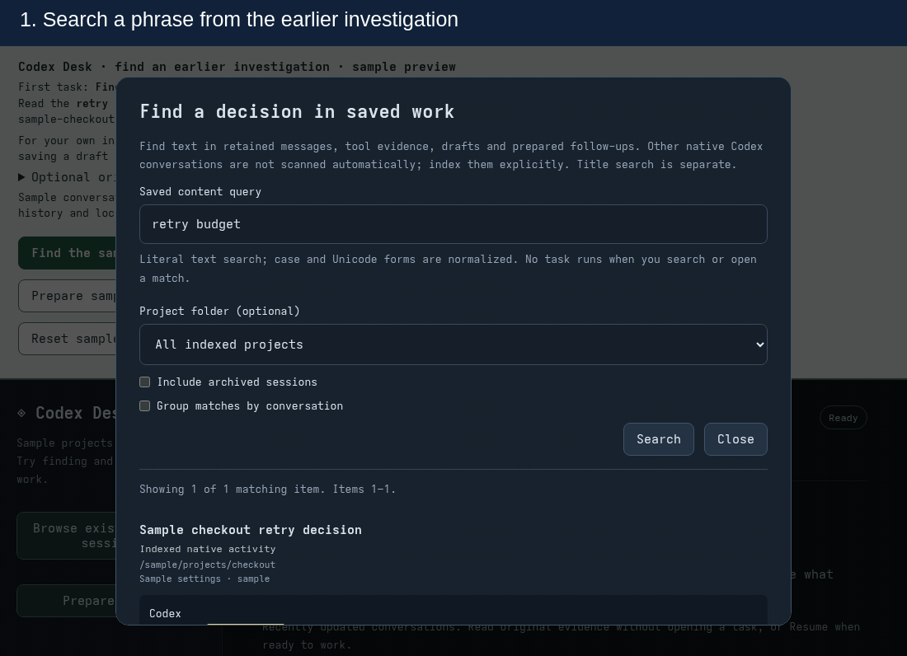

# Codex Desk

**Find an earlier Codex investigation before repeating it.** Search your recent local history, read the exact task’s response and its own supplied command or tool results, then decide which check to change or skip. Continue in the same native thread when you need to.


**[Try the browser sample — no install](https://blucca.github.io/codex-desk/demo/)**: search `retry budget`, read the checkout task’s response, then inspect its `printf sample-checkout` command and reported result. Optional: continue the sample conversation, save a draft, then reload to return. Sample preparation stays in this browser. Use the installer below for your own Codex history.



*20-second synthetic checkout walkthrough: search “retry budget” → read the exact answer → inspect its own command result. Decide which check to change or skip; continuing is optional.*

<a name="development-preview"></a>

## Install the preview

Use your existing [Codex CLI](https://developers.openai.com/codex/cli) installation and sign-in. Check `codex --version` in the terminal where you will launch Desk; this reports the native Codex CLI version. On macOS, you can also [use the Codex bundled with Desktop](https://github.com/blucca/codex-desk/blob/main/docs/find-desktop-answer.macos.md) through `--codex`, without installing another CLI. On Windows, [check the reader in your installed app](https://github.com/blucca/codex-desk/blob/main/docs/find-desktop-answer.windows.md); use that bundled entry when its version check succeeds in your ordinary PowerShell terminal.

With [uv](https://docs.astral.sh/uv/getting-started/installation/), **one command** installs and opens the free local workbench on Linux, macOS, Windows or WSL:

```sh
uvx --prerelease allow codex-desk
```

The current version is an alpha, so `--prerelease allow` selects the preview from [PyPI](https://pypi.org/project/codex-desk/). [The accepted GitHub wheel](https://github.com/blucca/codex-desk/releases) is also available.

Keep that terminal running. Desk opens the **complete launch URL printed in that terminal** in your browser (normally at `http://127.0.0.1:8787`). Run the same command next time and open its newly printed URL; your saved conversations and drafts remain local.

For your first task, pick one earlier investigation you would otherwise repeat. Choose **Find a decision in past work → Index existing Codex history**, enter a remembered phrase and choose **Search**, then **Read original conversation**. From the matching response or tool item, choose **Read containing task → Read this task’s evidence** to inspect the results supplied for that task. If its original supplies only messages, read the response; keep any check that still needs the missing command or tool result. Decide which check to change or skip; continuing the conversation is optional. [First-task guide](https://github.com/blucca/codex-desk/blob/main/docs/find-past-answer.md#first-task-read-the-decision-and-its-own-evidence). [Expected history missing?](https://github.com/blucca/codex-desk/blob/main/docs/find-past-answer.md#if-your-expected-investigation-is-missing)

If that address is already in use, use the complete URL in the existing Desk terminal to reopen that running server. To replace it with an updated version, stop its terminal with **Ctrl+C** before relaunching. To use a different port, append `--port 8788` to the launch command. An occupied port does not create or change Desk state.

### Update an existing uvx installation

uvx can reuse an older cached preview. First stop the running Desk terminal with **Ctrl+C**, then run this command once:

```sh
uvx --refresh --prerelease allow codex-desk@latest
```

Afterwards use the usual `uvx --prerelease allow codex-desk` launch command. Append any original `--codex`, `--codex-home`, `--state-dir` and `--port` options to the update and later launches. Reusing the same state directory retains your saved conversations, indexed history, drafts and prepared follow-ups. Check the selected Desk package version with `uvx --prerelease allow codex-desk --version`; `codex --version` checks your separate native Codex CLI installation.

<details>
<summary>Install with Python instead of uv</summary>

Python 3.11+ is required. The wheel has no runtime dependencies.

**Linux/macOS/WSL:**

```sh
mkdir -p "$HOME/codex-desk-install"
cd "$HOME/codex-desk-install"
python3 -m venv .venv
. .venv/bin/activate
python3 -m pip install --pre codex-desk
codex-desk
```

**Windows PowerShell:**

```powershell
New-Item -ItemType Directory -Force "$HOME\codex-desk-install" | Out-Null
Set-Location "$HOME\codex-desk-install"
py -3 -m venv .venv
.\.venv\Scripts\python.exe -m pip install --pre codex-desk
.\.venv\Scripts\codex-desk.exe
```

For later launches, use `codex-desk` in the activated environment, or `.\.venv\Scripts\codex-desk.exe` in PowerShell.

</details>

## Find, read, return

Pick one old investigation you would otherwise repeat:

1. **Find a decision in past work → Index existing Codex history**.
2. Search a phrase you remember. **Read original conversation** opens that exact result, including work whose project folder is gone.
3. **Read containing task → Read this task’s evidence** shows its own response and supplied command/tool results. Decide which check to change or skip today.

Know the title or native thread ID? Use **Browse all conversations** instead of indexing. When one conversation fills the search results, **Group matches by conversation** helps you choose another source. **Back to search** keeps your submitted query and result page.

Continuing is optional. **Continue this conversation** resumes the same native thread when its project folder exists. Prepare an unsent Work/Plan draft, save paused follow-ups, or carry a reviewed source excerpt into another task. A saved evidence reference returns to the original and then to the same preparation. Relaunch with the same state directory to keep saved work; use the newly printed complete URL.

| Need | Guide |
|---|---|
| Find an old answer or missing history | [First useful task](docs/find-past-answer.md) |
| Use a thread ID, title or remembered instruction | [Choose an entrance — English / 中文](docs/find-original-by-id-or-instruction.md) |
| Read a task’s answer and supplied evidence | [Task-led original review](docs/skim-original-tasks-and-evidence.md) |
| Save an exact quote and return to it | [Evidence preparation](docs/evidence-preparation.md) |
| Run, review approvals, stop, or recover a lost reply | [Workflow reference](docs/workbench.md) |
| Open existing work in Chinese | [中文指南](docs/first-project.zh-CN.md) |
| Compare native resume and other history tools | [Choose a history workflow](docs/choose-history-workflow.md) |

## Local by design

Desk runs on loopback and uses your installed Codex app-server. The printed URL carries a per-launch browser access fragment; the browser keeps it in this tab’s session storage and uses it for private API requests. After a server restart, open the newly printed complete URL. Existing sign-in, model/provider, MCP, trust and sandbox settings come from your Codex configuration. A new Desk account or API key is unnecessary.

Reading-place metadata stays in this browser’s local storage: native home namespace and source IDs, disclosure states, text-window/visible-character offsets and scroll positions. Original supplied-item snapshots retain an item count and exact turn/item boundary for the next deliberate fresh read. Desk reads native content afresh on return; these records contain view and identity metadata. Project bindings, cached activity, indexed native history and drafts live in `~/.local/state/codex-desk/desk.sqlite3`. History indexing and the original-conversation reader use native list/read requests; searching uses the local cache. New provider keys stay in a private local sidecar. Desk keeps your main configuration, auth and original rollouts intact. Native Codex sends model requests to your selected provider when you run a task.

Closing the browser leaves Desk running; **Ctrl+C** stops Desk and its owned native tasks. It runs its own app-server rather than attaching to an already-running Desktop backend.

Other launch options (append to either launcher):

```sh
codex-desk --codex /path/to/codex --no-browser
codex-desk --codex-home /your/codex-home --state-dir /your/desk-state --port 8788
codex-desk --version
```

The native launcher/profile smoke has passed on Ubuntu, Windows and macOS with CLI 0.171.0. Native task/MCP interaction acceptance uses Linux; browser first-use checks exercise desktop and 390px layouts.

## Feedback and development

[Task help](https://github.com/blucca/codex-desk/issues/new?template=task-help.yml): tell us which earlier decision you need, the step reached, and the first blocker or which check the original changed. [Browser sample feedback](https://github.com/blucca/codex-desk/issues/new?template=browser-preview.yml). Suggestions and contributions are welcome.

From a source checkout with Python 3.11+:

```sh
python3 -m codex_desk.server
```

Run the selected domain checks separately:

```sh
python3 -m unittest discover -s tests -p 'test_*.py'
```

Domain checks use disposable native homes and SQLite state under the checkout’s ignored `temp/`. Set `DESK_TEST_TEMP` to choose a different scratch directory.

[Daily CI](.github/workflows/daily-workbench.yml) runs the core domain lifecycle, one [installed Chromium journey](examples/check_native_evidence_preparation.py), and the [genuine WebKit clipboard path](examples/check_copy_excerpt_artifact.py). [Native CI](.github/workflows/native-smoke.yml) checks the installed launcher and retained profiles on Linux, Windows and macOS. Browser fixtures use controlled loopback history and native events. [Native MCP recording and fixture](docs/native-mcp-example.md) · [Build the browser sample](examples/browser-preview.md).

## License

MIT.
