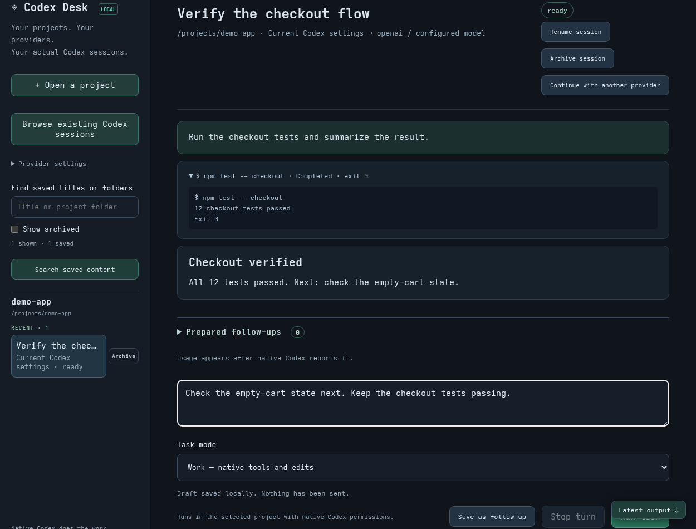
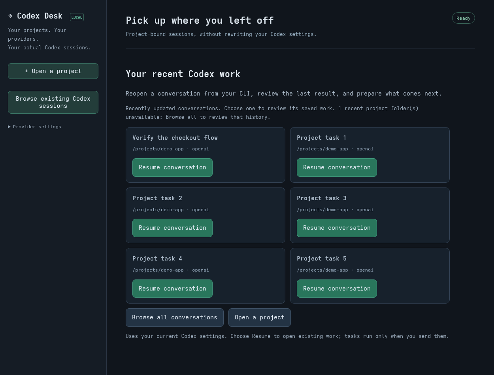

# Codex Desk

**Continue your Codex work in the browser.** Open a recent CLI conversation, read its last results, and pick up the next task in the same thread.



*Example project: review a completed checkout check and save the next task for later.*

<a name="development-preview"></a>

## Install the preview

Use your existing [Codex CLI](https://developers.openai.com/codex/cli) installation and sign-in. Check `codex --version` in the terminal where you will launch Desk.

With [uv](https://docs.astral.sh/uv/getting-started/installation/), **one command** installs and opens the free local workbench on Linux, macOS, Windows or WSL:

```sh
uvx --from https://github.com/blucca/codex-desk/releases/download/v0.1.0a22/codex_desk-0.1.0a22-py3-none-any.whl codex-desk
```

Keep that terminal running. Desk opens **http://127.0.0.1:8787** in your browser. Run the same command next time; your saved conversations and drafts remain local.

<details>
<summary>Install with Python instead of uv</summary>

Python 3.11+ is required. The wheel has no runtime dependencies.

**Linux/macOS/WSL:**

```sh
mkdir -p "$HOME/codex-desk-install"
cd "$HOME/codex-desk-install"
python3 -m venv .venv
. .venv/bin/activate
python3 -m pip install https://github.com/blucca/codex-desk/releases/download/v0.1.0a22/codex_desk-0.1.0a22-py3-none-any.whl
codex-desk
```

**Windows PowerShell:**

```powershell
New-Item -ItemType Directory -Force "$HOME\codex-desk-install" | Out-Null
Set-Location "$HOME\codex-desk-install"
py -3 -m venv .venv
.\.venv\Scripts\python.exe -m pip install https://github.com/blucca/codex-desk/releases/download/v0.1.0a22/codex_desk-0.1.0a22-py3-none-any.whl
.\.venv\Scripts\codex-desk.exe
```

For later launches, use `codex-desk` in the activated environment, or `.\.venv\Scripts\codex-desk.exe` in PowerShell.

</details>

## Bring your existing work

1. **Your recent Codex work** appears on the first screen, including the project folder. Click **Resume conversation** to open the one you want.
2. Read the saved messages, command results and tool evidence. Write your next task, or save it as a follow-up. Work and Plan modes use native Codex.
3. Close the page and return to the printed URL. Desk reopens your last saved conversation with its unsent draft. After stopping Desk with **Ctrl+C**, relaunch with the same command to return.



*Example first screen. Listing recent work runs no task; Resume is an explicit choice.*

Need older work? **Browse all conversations** searches native conversation titles across folders. **Open a project** lets you choose an exact folder, another retained profile, or explicitly start a new conversation. For a custom Codex history location, add `--codex-home /your/codex-home` to the launch command.

[中文：打开已有会话并继续工作](docs/first-project.zh-CN.md) · [Illustrated walkthrough](docs/task-walkthrough.md)

## Why use Desk?

- **Resume, don't reconstruct.** Reopen the actual saved CLI thread and its prior messages, commands, file changes and MCP results.
- **Keep several projects moving.** Active tasks and approvals stay visible while you read another project's results.
- **Prepare tomorrow's work.** Session-bound drafts and ordered follow-ups persist across page and server restarts. Choose when to send them.
- **Review before changing provider.** Carry editable visible task evidence into a distinct target-provider conversation, preserving the original.
- **Find a saved decision.** Search readable evidence cached by Desk and jump to the exact message, tool result or preparation.

[Workflow reference: search, profiles, follow-ups, handoffs and usage](docs/workbench.md)

## Local by design

Desk runs on loopback and uses your installed Codex app-server. Existing sign-in, model/provider, MCP, trust and sandbox settings come from your Codex configuration. A new Desk account or API key is unnecessary.

Project bindings, cached activity and drafts live in `~/.local/state/codex-desk/desk.sqlite3`. New provider keys stay in a private local sidecar. Desk keeps your main configuration, auth and original rollouts intact. Native Codex sends model requests to your selected provider.

Closing the browser leaves Desk running; **Ctrl+C** stops Desk and its owned native tasks. It runs its own app-server rather than attaching to an already-running Desktop backend.

Other launch options (append to either launcher):

```sh
codex-desk --codex /path/to/codex --no-browser
codex-desk --codex-home /your/codex-home --state-dir /your/desk-state --port 8788
codex-desk --version
```

The native launcher/profile smoke has passed on Ubuntu, Windows and macOS with CLI 0.171.0. Native task/MCP interaction acceptance uses Linux; browser first-use checks exercise desktop and 390px layouts.

## Feedback and development

[Report a bug or ask for workflow help](https://github.com/blucca/codex-desk/issues/new/choose). Tell us the one task you were trying to finish, your OS/CLI version, and where you got stuck. Suggestions and contributions are welcome.

From a source checkout:

```sh
python3 -m codex_desk.server
python3 -m unittest discover -s tests
```

Browser regressions use controlled local HTTP/SQLite, with no provider calls. See [the first-use test](tests/browser_home.py) and [installed daily-workflow CI](.github/workflows/daily-workbench.yml). [Native MCP fixture and result walkthrough](docs/native-mcp-example.md).

## License

MIT.
