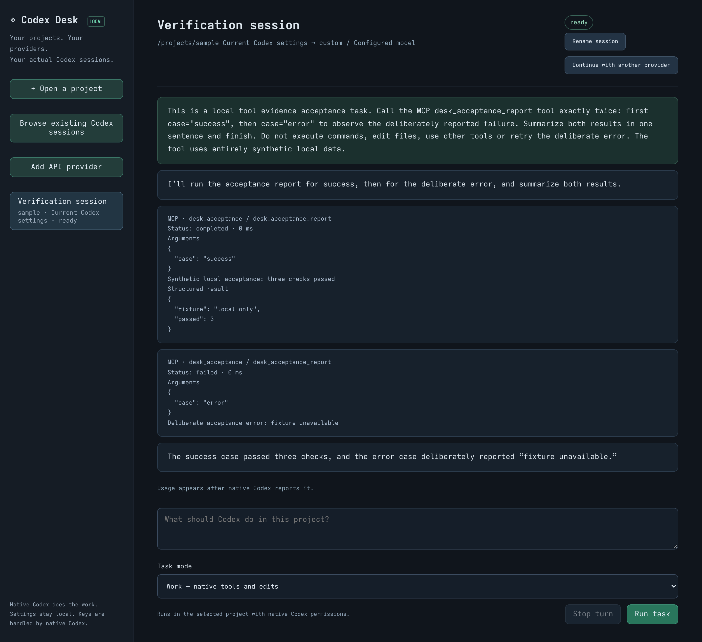

# Codex Desk：打开第一个项目，继续已有会话

[五步图解：查找会话 → 阅读结果 → 验证任务 → 再次打开](task-walkthrough.md)（英文，使用本地示例）

适用于当前预览版。Codex Desk 在本机浏览器中展示项目会话、命令输出、MCP 工具结果、失败和原生用量；实际任务由已安装的 Codex CLI 执行。界面目前使用英文，下面保留实际按钮名称。



*项目自有的合成 MCP 示例：文本和结构化结果、刻意触发的工具失败，以及重新打开的会话。*

## 1. 安装并启动

准备 **Python 3.11+** 和完整的 **Codex CLI**。先按 [Codex CLI 官方安装说明](https://developers.openai.com/codex/cli)安装并完成登录或提供商配置，在准备启动 Desk 的同一终端确认 `codex --version` 可用。当前原生集成已在 **Linux / Codex CLI 0.171.0** 上运行验证。

先在同一终端确认 `python3 --version`（Windows 用 `py -3 --version`）为 3.11 或更高，且 `codex --version` 可用。

按[维护中的安装步骤](../README.md#install-the-preview)选择 **Linux/macOS/WSL** 或 **Windows PowerShell** 命令，在独立安装目录创建虚拟环境、安装当前已发布预览包并启动 Desk。发布包安装不需要 Git；网页中再选择实际项目目录。安装包地址以该页面为准。

Desk 会打印 **`http://127.0.0.1:8787`** 并打开浏览器；使用终端打印的完整地址。需要指定 Codex 启动器或手动打开浏览器时，可用 `codex-desk --codex /path/to/codex --no-browser`。

## 2. 选择已有会话或新会话

1. 点击 **Open a project**，在 **Project folder** 输入实际项目的完整路径。使用 WSL 启动 Desk 时，输入 WSL 中可访问的路径。
2. 首次续接，在 **Provider profile** 保持 **Current Codex settings**，使用当前 Codex 配置。
3. 点击 **Find existing sessions**，查看这个项目的 **Saved conversations**；需要更多结果时点击 **Load more**。
4. 找到要继续的会话，点击 **Resume this conversation**。要开始独立的新任务，则填写可选的 **New conversation name (optional)**，点击 **Start new conversation**。

若已知部分会话标题，在 **Search conversation titles** 输入这些文字，再点击 **Find existing sessions** 或按 Enter。侧栏的 **Browse existing Codex sessions** 可跨项目浏览所选 Codex home 中的原生会话；在其中输入标题文字并点击 **Search titles**。修改搜索文字会清空旧结果和分页，需要再次提交；标题框留空则列出当前范围内的会话，**Load more** 继续同一次搜索和范围。

项目列表按会话保存的工作目录（`cwd`）精确匹配：在子目录中创建的会话，需要输入该子目录或使用侧栏的全局浏览。标题搜索按子串匹配原生提取出的会话标题，不搜索消息正文、命令输出或 MCP 结果。

全局列表中的 **Resume with current settings** 使用当前 Codex 配置。新建但还未发送过任务的空会话，原生 Codex 尚未写入会话记录（rollout），重启后可能获得新的原生线程（thread）；已使用过的会话按保存的 thread 续接。

## 3. 先看证据，再发一个只读任务

打开已有会话后，先确认页眉的项目路径、提供商和模型，再阅读历史消息、实际命令输出与退出状态、文件变化，以及已有的 MCP 文本／结构化结果和失败。

在 **Task mode** 选择 **Work — native tools and edits**，输入下面这个只读检查任务，然后点击 **Run task**：

```text
只读检查这个项目：列出项目根目录的一层文件，读取 README（若存在），找出其中说明的验证命令。报告实际执行的命令、输出和退出状态；若未记载验证命令，直接说明未找到。只说明验证命令，不运行它，不安装依赖，不修改文件。
```

出现原生命令审批时，查看实际命令后点击 **Allow once**；拒绝该命令用 **Decline**。需要中断当前任务用 **Stop turn**。任务结束后核对命令结果；**Thread usage** 显示原生 Codex 最近报告的当前 thread 累计用量。

可用 **Rename session** → **Save name** 为会话取一个容易再次找到的名字。

## 4. 关闭页面后怎样回来

- **只关闭浏览器：** Desk 终端和后台任务继续运行。重新打开终端打印的 URL，在侧栏选择同一个命名会话，核对刚才的消息和命令结果后继续。
- **停止 Desk：** 在启动它的终端按 **Ctrl+C**，Desk 会停止自己管理的 app-server 和正在运行的原生任务。下次从同一个虚拟环境启动，并沿用相同的 Codex home 和 Desk state directory，再选择该会话。

再次启动不需要重新安装：

```sh
cd "$HOME/codex-desk-install"
. .venv/bin/activate
codex-desk
```

PowerShell 对应为：

```powershell
Set-Location "$HOME\codex-desk-install"
.\.venv\Scripts\codex-desk.exe
```

若之前使用 `--codex-home`、`--state-dir` 或 `--codex`，再次启动时保留这些参数；依赖环境变量提供密钥的配置，也从设置了该变量的终端启动。

## 5. 当前配置、提供商 profile 与交接

[提供商切换任务指南（英文）](https://blucca.github.io/guides/switch-codex-api-provider/)：核对本地 API profile，审阅旧会话证据，运行一个验证任务，再次打开新会话。

**Current Codex settings** 使用主配置。已有的原生文件 profile 会出现在下拉框；**Add API provider** 可保存新的本地 profile。表单填写 **Profile name**（1–41 个英文字母、数字、下划线或连字符，首字符为字母或数字）、**API base URL**、账户可用的准确 **Model** 和已有 **API key**，点击 **Save local profile**。该账户需支持 Responses API，base URL 使用提供商为 Codex 指定的完整地址。

在项目对话框选择 profile 后点击 **Resume this conversation**，仍然续接原来的原生 thread，只是使用所选配置；这不是交接到新 thread。名为 `default` 的文件 profile 与 **Current Codex settings** 是不同选项。

要把可见工作证据交给另一提供商，使用以下流程：

1. 在打开的会话点击 **Continue with another provider**，或在原生历史列表点击 **Review handoff**。
2. 在 **Review the handoff** 中核对可见消息、命令、文件变化和 MCP 结果，编辑完成情况与剩余工作，并查看省略提示。填写 **What should Codex do next?**，确认 **Project folder** 和 **Next provider**。
3. 点击 **Start new native conversation**，Desk 会创建**不同的原生 thread**，立即向目标提供商运行你审阅后的交接文本和下一目标。原会话 rollout 保持原样。

只读取或审阅交接文本不运行模型回合，也不向旧提供商请求压缩。交接使用可见任务证据，加密推理内容（reasoning）不重放到新 thread。

## 6. 本地记录与任务求助

Desk 的项目／profile／原生 thread 绑定和活动记录保存在本机 SQLite，默认路径为 `~/.local/state/codex-desk/desk.sqlite3`；活动包括任务文本和命令输出。Desk 没有托管的活动存储服务，模型请求由原生 Codex 发往所选提供商。

已有密钥沿用 Codex 配置或启动进程的环境。新 profile 的密钥保存在本地 sidecar 文件（Linux 权限 0600），配置通过 app-server 的私有 stdin 协议传入。Desk 保留主配置、auth 和原生 rollout，继承主配置中的 MCP、项目 trust 和 sandbox 设置。

**Add API provider** 中有明确标注的可选 CometAPI、88API 联盟账户链接；通过这些链接使用服务可能为 Blucca 带来佣金。现有账户和密钥也可直接使用。

需要协助完成一个项目任务或续接时，[填写任务求助表单](https://github.com/blucca/codex-desk/issues/new?template=task-help.yml)：

- **Operating system**：Linux、macOS、Windows、WSL 或 Other。
- **Codex CLI version**：启动 Desk 的终端中 `codex --version` 的完整输出。
- **The task you want to complete**：一个具体的项目／会话目标。
- **Step reached**：选择已到达的英文步骤，见下表。
- **Short error text (optional)**：可选的短错误原文，去掉密钥、私有 URL 和项目路径。

| Step reached 选项 | 对应步骤 |
| --- | --- |
| Install and launch | 安装与启动 |
| Find/import saved conversation | 查找／导入已有会话 |
| Resume/send task | 续接／发送任务 |
| Tool approval or planning question | 工具审批或规划问题 |
| New-provider handoff | 新提供商交接 |
| Return after closing/stopping | 关闭页面／停止后返回 |
| Other | 其他 |

## 阅读长任务，留在当前项目

助手结果按标题、列表和代码块显示；代码块的 **Copy** 只复制代码文本。命令、文件改动与 MCP 结果收在可展开的证据卡片里，进行中的工具默认展开。手动收起或展开后，后续输出不会改变你的选择。

阅读旧结果时新输出不会把页面拉到底部。点击 **Latest output ↓** 回到最新结果和任务输入框；本来就在底部时会跟随新输出。切到另一个项目后，侧栏仍更新先前项目的等待批准和完成状态，浏览器标题显示活跃任务数。

## 找不到已有会话的历史时

如果打开已保存会话时提示 `no rollout found`，Desk 保留原会话绑定。恢复该会话的历史文件，或用原来的 `--codex-home` 重新启动 Desk 后再打开；要开始无旧上下文的新工作，请明确选择 **Start new conversation**。新建但从未运行任务的空会话才可能自动重建。

添加同名提供商、打开不存在的交接目录或恢复已删除的项目失败时，错误显示在当前对话框内。修改后重试即可；提供商表单保留名称、地址和模型，API key 需重新输入。

## 保留下一步任务和供应商配置

在任务输入框准备下一步，并选择 **Work** 或 **Plan**。看到 **Draft saved locally** 后，文字和模式已保存在这个 Desk 会话的本地数据库；刷新页面或用相同 state directory 重启 Desk 后会恢复，不会自动执行。发送失败时保留草稿。若另一标签页修改了同一草稿，选择 **Keep this tab draft**（保留当前标签页）或 **Load saved draft**（读取已保存草稿），然后再继续。

选择 **Manage API profiles** → **Edit profile**，可以修改 Desk 创建的接口地址／模型，或轮换密钥，供应商名称和已有会话绑定不变。密钥留空即保留原值。当前 Codex 配置及自定义原生配置文件仍由其原文件管理。已经加载该配置的原生后端不会被热切换；保存后若提示仍在使用，按 **Ctrl+C** 停止 Desk，再用原参数启动，便会加载新配置。

## 按项目整理活跃／最近会话

侧栏按项目分组。**Active** 显示正在运行和等待批准的任务，**Recent** 显示空闲会话。**Find saved work** 按本地标题或项目目录筛选，不切换当前会话。

**Archive session** 只把空闲的 Desk 条目从最近列表隐藏，原生历史、供应商绑定、草稿和已准备的后续任务都保留。勾选 **Show archived** 后点击 **Restore** 可恢复；仍在运行的归档会话继续显示在 Active，便于批准或停止。从原生历史再次打开时，也会复用并恢复原绑定。

## 提前准备多个后续任务

在输入框写任务、选择 **Work** 或 **Plan**，再点 **Save as follow-up**。任务存入当前 Desk 会话和供应商的准备列表，即使上一项任务还在运行也可准备。展开 **Prepared follow-ups** 可以编辑、删除、上下移动或清空已准备的内容。

上一项结束后，点 **Send next** 只提交一项到它所属的会话。提交途中切换项目不会改变目标；剩余内容保持暂停。重新打开页面或重启 Desk 都不会自动执行。

若无法确认启动结果，列表保留当时提交的指令。先检查该会话活动记录，再选 **It started — record accepted**（已启动，记为接受）或 **It did not start — keep prepared**（未启动，保留准备）。未确认的启动会阻止下一次提交；提交后又编辑过的内容不会被旧回执删除。

## 原生容量和失败状态

用量区分别显示原生累计输入／输出、最新请求输入和模型报告的上下文窗口。累计用量不当作当前占用比例。原生自动重试显示 **Native retry in progress**；最终失败卡片保留错误正文、类型及 HTTP 信息，并按真实错误给出检查模型／密钥、等待限流或新会话交接的下一步。先前的任务和工具输出仍可阅读。
