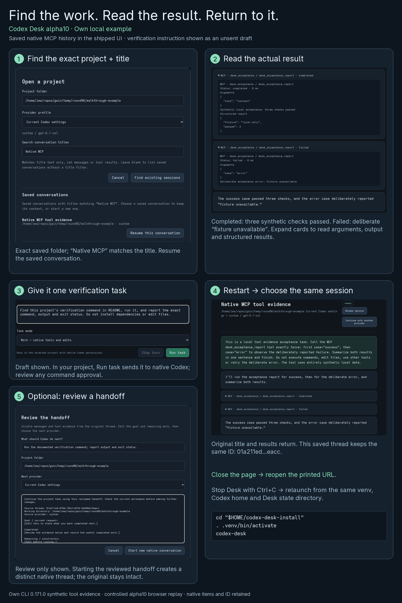

# One project task. The same conversation when you return.

**Codex Desk** — find a saved conversation, read its tool evidence, give it one next task, then return to the same native thread.



*Own local example: synthetic native MCP results from CLI 0.171.0/Linux, replayed in alpha10's shipped UI with a controlled local transport. Native items and thread ID preserved; folder relocated. Verification is an unsent draft; handoff is review-only. Prior native acceptance checked same-ID restart.*

## Install and open

Use the [one-command installer](../README.md#install-the-preview) with a complete, configured [Codex CLI](https://developers.openai.com/codex/cli). Check `codex --version` in the shell you will use for Desk; this is the native CLI version.

Follow the [maintained installer](../README.md#install-the-preview), choosing **Linux/macOS/WSL** or **Windows PowerShell** commands. With uv, run `uvx --prerelease allow codex-desk`; the Python 3.11+ virtual-environment route is also available. Both install the current published preview without Git. Launch Desk, then open its printed loopback URL, normally **http://127.0.0.1:8787**. [中文 first-project guide](first-project.zh-CN.md).

## A 90-second walkthrough

**0–15s · Find the work.** On the first screen, choose **Resume conversation** beside your recent work. For older work or a specific profile, choose **Open a project**, enter its exact saved working directory, and keep **Current Codex settings**. Enter part of your conversation title, then choose **Find existing sessions** and resume it. This example searches “Native MCP” and opens **Native MCP tool evidence**. Search matches titles, not tool output; use **Browse all conversations** on the first screen or **Browse existing Codex sessions** in the sidebar across folders. Choose **Read original conversation** first if you only need an old result.

**15–35s · Read the result.** Expand both MCP cards: three synthetic checks passed, with `passed: 3` in the structured result; the deliberate failure says “fixture unavailable.” Read the tool evidence alongside the summary.

**35–55s · Give it one next task.** Choose **Work — native tools and edits** and enter:

```text
Find this project's verification command in README, run it, and report the exact command, output and exit status. Do not install dependencies or edit files.
```

Click **Run task** in your project. Review any native command approval, then check actual output and exit status.

**55–80s · Return.** Close the page and reopen the printed URL: the last selected task and its saved draft return. Use **Recent work** to inspect other originals without leaving that task. To restart Desk, press **Ctrl+C**, then relaunch below using the original Codex home and state directory. The saved used conversation resumes its original native thread.

**80–90s · Optional branch.** **Continue with another provider** opens a handoff to review. Choose the next goal and profile. **Start new native conversation** creates a distinct thread, keeping the original intact.

## Next launch — no reinstall

With uv, repeat the launch command in the [README](../README.md#install-the-preview). To update an older cached preview, stop the old Desk terminal with **Ctrl+C** first, then use the [one-time uvx update command](../README.md#update-an-existing-uvx-installation). Reopening an occupied URL still uses the server already running there. With the Python virtual-environment installation:

```sh
cd "$HOME/codex-desk-install"
. .venv/bin/activate
codex-desk
```

Reuse any original `--codex`, `--codex-home`, `--state-dir` and `--port` arguments for updates and later launches. The same state directory retains the saved conversation, indexed history and preparation. Stopping Desk also stops its owned native tasks; closing just the browser leaves the backend running.

## Full-size panels

[1 · Find](images/task-walkthrough-01-find.png) · [2 · Read](images/task-walkthrough-02-read.png) · [3 · Task draft](images/task-walkthrough-03-task-draft.png) · [4 · Return](images/task-walkthrough-04-return.png) · [5 · Handoff review](images/task-walkthrough-05-handoff-review.png)

[1200×630 overview card](images/task-walkthrough-card.png). For a task you want to finish, [ask for project-task help](https://github.com/blucca/codex-desk/issues/new?template=task-help.yml) with your CLI version, operating system, task and step reached.
